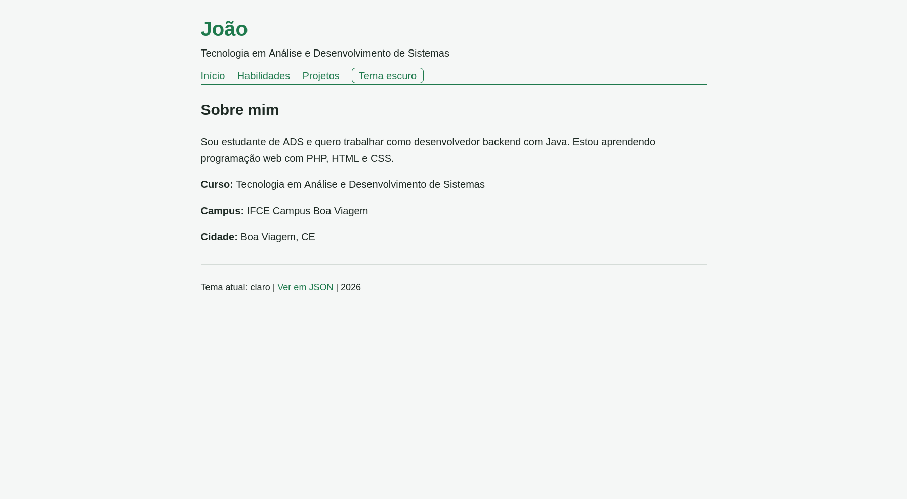
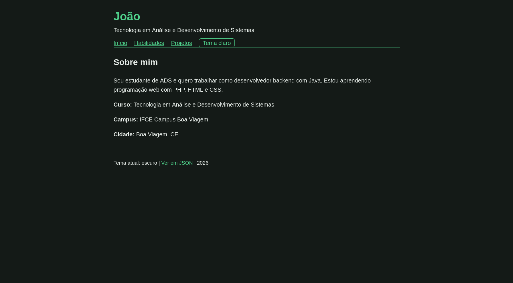

# Perfil do Estudante: versão 2 (com classes)

**Autor(a):** Halef

## Como executar

```
cd projeto/v2
php -S localhost:8000
```

Abra http://localhost:8000

## 1. Telas

| Tema claro | Tema escuro |
|---|---|
|  |  |

## 2. As classes

### 2.1 Classe `Projeto`

**Atributos**

| Atributo | Tipo | Visibilidade |
|---|---|---|
| `$titulo` | `string` | `private` |
| `$descricao` | `string` | `private` |
| `$tecnologias` | `string` | `private` |

**Métodos**

| Método | O que faz |
|---|---|
| `__construct(string $titulo, string $descricao, string $tecnologias)` | Recebe os três valores. Se o título estiver vazio (`trim($titulo) === ''`), lança uma exceção com a mensagem `O projeto precisa de um título.`; se estiver tudo certo, guarda os valores. |
| `getTitulo(): string` | Devolve o título. |
| `getDescricao(): string` | Devolve a descrição. |
| `getTecnologias(): string` | Devolve as tecnologias. |
| `paraArray(): array` | Devolve `titulo`, `descricao` e `tecnologias` em um array associativo, para o `json_encode` conseguir ler. |

### 2.2 Classe `Perfil`

**Atributos**

| Atributo | Tipo | Visibilidade |
|---|---|---|
| `$nome` | `string` | `private` |
| `$curso` | `string` | `private` |
| `$campus` | `string` | `private` |
| `$cidade` | `string` | `private` |
| `$apresentacao` | `string` | `private` |
| `$habilidades` | `array` | `private` |
| `$projetos` | `array` (começa vazio) | `private` |

**Métodos**

| Método | O que faz |
|---|---|
| `__construct(string $nome, string $curso, string $campus, string $cidade, string $apresentacao, array $habilidades)` | Recebe tudo, menos os projetos. Se houver menos de 5 habilidades, lança uma exceção com a mensagem `O perfil precisa de pelo menos 5 habilidades.`; se estiver tudo certo, guarda os valores. |
| `adicionarProjeto(Projeto $projeto): void` | Guarda o projeto na lista, numerando a partir de 1 (`count($this->projetos) + 1`). O tipo `Projeto` na assinatura recusa qualquer outra coisa. |
| `getProjeto(int $id): Projeto` | Devolve o projeto com aquele número. Se ele não existir, lança uma exceção com a mensagem `Projeto não encontrado.` |
| `getNome()`, `getCurso()`, `getCampus()`, `getCidade()`, `getApresentacao()` | Devolvem cada atributo de texto. |
| `getHabilidades(): array` | Devolve a lista de habilidades. |
| `getProjetos(): array` | Devolve a lista de objetos `Projeto`, com os números como chaves. |
| `paraArray(): array` | Devolve `perfil` (os dados pessoais e as habilidades) e `projetos`, com cada projeto convertido pelo seu próprio `paraArray()`. |

## 3. Antes e depois

### 3.1 O 404 do projeto

**Antes (v1):** a página olhava dentro do array para saber se o projeto existia.

```php
} elseif ($pagina === 'projeto') {
    $id = (int) ($_GET['id'] ?? 0);
    if (isset($projetos[$id])) {
        $titulo = $projetos[$id]['titulo'];
    } else {
        http_response_code(404);
        $pagina = 'projeto-nao-encontrado';
        $titulo = 'Projeto não encontrado';
    }
}
```

**Depois (v2):** quem sabe se o projeto existe é o `Perfil`. A página só pergunta e reage se ele recusar.

```php
} elseif ($pagina === 'projeto') {
    $id = (int) ($_GET['id'] ?? 0);
    try {
        $projetoAtual = $perfil->getProjeto($id);
        $titulo = $projetoAtual->getTitulo();
    } catch (Exception $e) {
        http_response_code(404);
        $pagina = 'projeto-nao-encontrado';
        $titulo = $e->getMessage();
    }
}
```

**O que mudou:** o `isset` e a chave `['titulo']` saíram do `index.php`. Agora o código chama `getProjeto()` e `getTitulo()`, que são métodos da classe.

**O que melhorou:**

- Se eu digitar errado a chave na v1 (`$projetos[$id]['titulo ']`), o PHP só avisa e devolve vazio. Na v2, um método com nome errado dá erro na hora.
- A regra "esse projeto não existe" fica em um lugar só, dentro de `Perfil::getProjeto()`, e a mensagem de erro vem da própria classe (`$e->getMessage()`), em vez de um texto repetido no HTML.
- Se um dia a lista de projetos deixar de ser um array, o `index.php` não precisa mudar.

### 3.2 A página de projetos

**Antes (v1):**

```php
<?php foreach ($projetos as $numero => $projeto): ?>
  <h3><?= htmlspecialchars($projeto['titulo']) ?></h3>
  <p><?= htmlspecialchars($projeto['tecnologias']) ?></p>
```

**Depois (v2):**

```php
<?php foreach ($perfil->getProjetos() as $numero => $projeto): ?>
  <h3><?= htmlspecialchars($projeto->getTitulo()) ?></h3>
  <p><?= htmlspecialchars($projeto->getTecnologias()) ?></p>
```

**O que mudou e melhorou:** o visual é o mesmo, mas o HTML agora só usa a interface pública das classes (os getters). Como o `foreach` percorre `getProjetos()`, se eu adicionar um quarto projeto com `adicionarProjeto`, ele aparece na lista, nos detalhes (`id=4`) e no JSON sem mudar o HTML.

## 4. As classes se recusam

Para testar, troquei temporariamente os dados, rodei o servidor, copiei a mensagem do log e desfiz a alteração antes do commit.

**4.1 Projeto sem título.** Troquei o título do primeiro projeto por `''`:

```text
PHP Fatal error:  Uncaught Exception: O projeto precisa de um título. in .../projeto/v2/index.php:11
Stack trace:
#0 .../projeto/v2/index.php(154): Projeto->__construct()
#1 {main}
  thrown in .../projeto/v2/index.php on line 11
[::1]:59626 [500]: GET / - Uncaught Exception: O projeto precisa de um título.
```

**Explicação:** a mensagem vem da linha 11, que é o `throw new Exception(...)` dentro do construtor de `Projeto`. O `Stack trace` mostra que o construtor foi chamado na linha 154, no `new Projeto('', ...)` do `index.php`. O `throw` acontece antes de os atributos serem guardados, e o `new` não termina: a exceção interrompe o construtor, então nenhum objeto é entregue e nada chega a ser adicionado ao perfil. Como nenhum `try/catch` pegou a exceção, o PHP encerrou o script com `Fatal error`, e o servidor respondeu `500` sem enviar a página.

**4.2 Perfil com poucas habilidades.** Deixei só 4 habilidades (`['HTML', 'CSS', 'PHP', 'Git']`):

```text
PHP Fatal error:  Uncaught Exception: O perfil precisa de pelo menos 5 habilidades. in .../projeto/v2/index.php:63
Stack trace:
#0 .../projeto/v2/index.php(145): Perfil->__construct()
#1 {main}
  thrown in .../projeto/v2/index.php on line 63
[::1]:59630 [500]: GET / - Uncaught Exception: O perfil precisa de pelo menos 5 habilidades.
```

**Explicação:** a mensagem vem da linha 63, o `throw` dentro do construtor de `Perfil`, que confere `count($habilidades) < 5` antes de guardar qualquer coisa. O construtor foi chamado na linha 145, no `new Perfil(...)`. Como o `new` não termina, a variável `$perfil` nunca recebe um objeto, e por isso o script nem chega a mostrar a página. O resultado é o mesmo: `Fatal error` e status `500`.

**Por que isso é melhor que os arrays da v1:** na v1, um projeto sem título ou um perfil com 4 habilidades existiriam normalmente. Agora a regra mora dentro da classe, e um objeto inválido não consegue ser criado.

## 5. Saídas do terminal

**5.1 Um projeto que existe:** `curl -i "http://localhost:8000/?pagina=projeto&id=2"` (até o início do HTML)

```text
HTTP/1.1 200 OK
Host: localhost:8000
Date: Thu, 29 Oct 2026 01:20:07 GMT
Connection: close
X-Powered-By: PHP/8.5.12
Content-type: text/html; charset=UTF-8

<!DOCTYPE html>
<html lang="pt-BR">
<head>
  <meta charset="UTF-8">
  <meta name="viewport" content="width=device-width, initial-scale=1">
  <title>PizzarIA | Meu perfil</title>
  <link rel="stylesheet" href="estilo.css">
</head>
<body class="tema-claro">
```

**Explicação:** `200 OK` quer dizer que `getProjeto(2)` encontrou o projeto e não lançou exceção. O `<title>` é `PizzarIA` porque o `index.php` usou `$projetoAtual->getTitulo()`. O `<body>` está com `tema-claro` porque não havia tema na URL nem cookie.

**5.2 Um projeto que não existe:** `curl -i "http://localhost:8000/?pagina=projeto&id=99"` (até o início do HTML)

```text
HTTP/1.1 404 Not Found
Host: localhost:8000
Date: Thu, 29 Oct 2026 01:20:07 GMT
Connection: close
X-Powered-By: PHP/8.5.12
Content-type: text/html; charset=UTF-8

<!DOCTYPE html>
<html lang="pt-BR">
<head>
  <meta charset="UTF-8">
  <meta name="viewport" content="width=device-width, initial-scale=1">
  <title>Projeto não encontrado. | Meu perfil</title>
  <link rel="stylesheet" href="estilo.css">
</head>
<body class="tema-claro">
```

**Explicação:** `getProjeto(99)` não achou o projeto e lançou a exceção `Projeto não encontrado.`. O `catch` pegou a exceção, chamou `http_response_code(404)` e usou `$e->getMessage()` como título, e por isso o `<title>` mostra o texto com ponto final. Diferente da v1, esse texto vem da classe, não do HTML.

**5.3 A API:** `curl -i "http://localhost:8000/?formato=json"`

```text
HTTP/1.1 200 OK
Host: localhost:8000
Date: Thu, 29 Oct 2026 01:20:07 GMT
Connection: close
X-Powered-By: PHP/8.5.12
Content-Type: application/json; charset=utf-8

{
    "perfil": {
        "nome": "João",
        "curso": "Tecnologia em Análise e Desenvolvimento de Sistemas",
        "campus": "IFCE Campus Boa Viagem",
        "cidade": "Boa Viagem, CE",
        "apresentacao": "Sou estudante de ADS e quero trabalhar como desenvolvedor backend com Java. Estou aprendendo programação web com PHP, HTML e CSS.",
        "habilidades": [
            "HTML",
            "CSS",
            "PHP",
            "Git",
            "Java",
            "Linux"
        ]
    },
    "projetos": {
        "1": {
            "titulo": "Calculadora de média",
            "descricao": "Calcula a média de duas notas recebidas pela URL.",
            "tecnologias": "PHP, HTML"
        },
        "2": {
            "titulo": "PizzarIA",
            "descricao": "Sistema de pizzaria com atendimento por IA.",
            "tecnologias": "UML, Arquitetura de software"
        },
        "3": {
            "titulo": "Perfil do Estudante",
            "descricao": "Este site: um perfil pessoal com páginas, tema com cookie e API em JSON.",
            "tecnologias": "PHP, HTML, CSS"
        }
    }
}
```

**Explicação:** o cabeçalho `Content-Type: application/json; charset=utf-8` e as opções do `json_encode` (`JSON_PRETTY_PRINT | JSON_UNESCAPED_UNICODE`) são os mesmos da v1. O que mudou é a origem dos dados: agora o `json_encode` recebe `$perfil->paraArray()`. Para provar que o resultado é igual ao da v1, salvei o JSON das duas versões (v1 na porta 8001 e v2 na porta 8000) e comparei com `diff`:

```text
1136 /tmp/v1.json
1136 /tmp/v2.json
2272 total
(sem diferenças)
```

## 6. Perguntas

**(a) Por que `json_encode($perfil)` devolve `{}`?**

Porque o `json_encode` só consegue ler os atributos `public` de um objeto, e os atributos de `Perfil` são `private`. De fora da classe, o `json_encode` não enxerga nenhum deles, então o objeto parece vazio e vira `{}`. É por isso que as classes têm o método `paraArray()`: de dentro da classe, ele pode ler os atributos privados e montar um array comum, que o `json_encode` sabe converter.

**(b) Os objetos `$perfil` e `$projeto` continuam na memória do servidor depois que a página é enviada? Por quê?**

Não. A cada requisição, o PHP executa o `index.php` do começo ao fim: cria os objetos com `new`, monta a página e, quando o script termina, libera a memória, junto com todos os objetos. Na próxima requisição tudo é criado de novo do zero. O log do servidor mostra isso: cada requisição tem seu próprio `Accepted` e `Closing`. É também por isso que o tema precisa de um cookie: o objeto não guarda nada entre uma visita e outra, então quem lembra a escolha é o navegador.

**(c) Por que os atributos são `private`, e não `public`?**

Para proteger as regras da classe. A validação mora no construtor: se os atributos fossem `public`, qualquer código poderia fazer `$projeto->titulo = ''` depois de o objeto ser criado e quebrar a regra "o projeto precisa de um título". Com `private`, o único jeito de mudar um dado é passar por métodos da classe, que podem validar. Isso também deixa a classe livre para mudar por dentro (por exemplo, trocar o array `$projetos` por outra estrutura) sem quebrar o `index.php`, que só usa os getters. E, na v1, uma chave digitada errada virava uma chave nova; aqui, tentar acessar um atributo privado de fora dá erro na hora.
